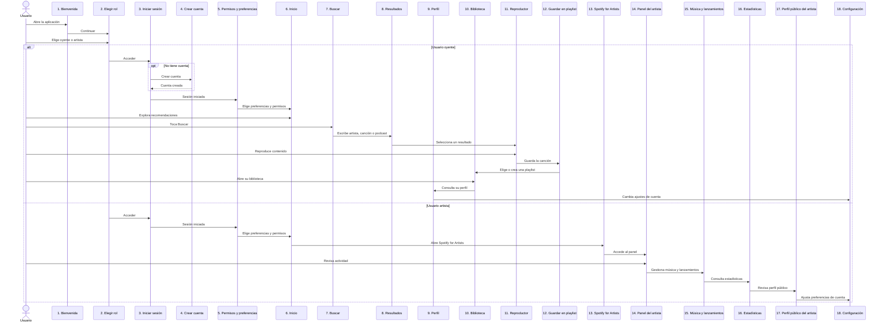

# Práctica 06: Secuencia de pantallas — Spotify

## Descripción

Esta práctica presenta el flujo de experiencia de una aplicación móvil inspirada en Spotify. Incluye dos roles —oyente y artista—, las pantallas que comparten y las vistas específicas de cada recorrido.

## Entregables

- [Abrir los sketches interactivos](https://artvrolouv.github.io/PRACTICAS_INTEGRADORA_230629/Practica06/spotify-sketches.html): prototipos visuales de 18 pantallas con paleta oscura, verde y violeta, y una marca ilustrativa inspirada en Spotify.
- Diagrama Mermaid de secuencia que muestra la navegación entre pantallas y la bifurcación por rol.

El HTML es autocontenido: descarga o conserva el archivo junto a este README y ábrelo en un navegador para recorrer las secciones de pantallas compartidas, oyente y artista.

## Roles

- **Oyente:** explora recomendaciones, busca música, reproduce canciones, guarda playlists y consulta su biblioteca y perfil.
- **Artista:** entra a Spotify for Artists, revisa el panel, gestiona lanzamientos, consulta estadísticas y previsualiza su perfil público.

## Diagrama de secuencia

